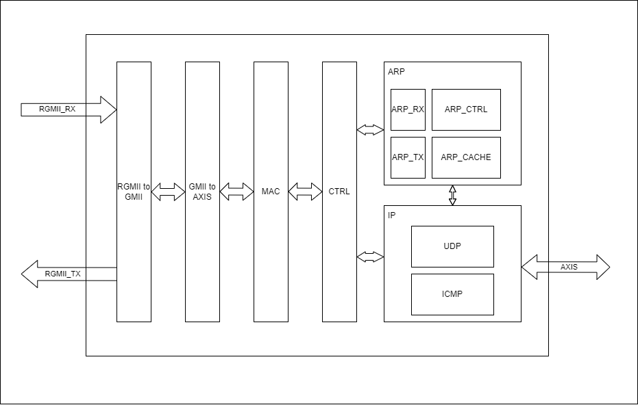

# 以太网协议栈设计架构

## 架构图

## 架构介绍

整个以太网协议栈包括以下功能

- RGMII接口转GMII接口 (可选)
- GMII接口转AXI Stream接口
- 以太网MAC层数据解帧和组帧
- 以太网控制仲裁模块
- ARP协议
  - ARP 数据包接收模块
  - ARP 数据包发送模块
  - ARP 控制模块
  - ARP CACHE模块
- IP协议
  - IP 数据包接收模块
  - IP 数据包发送模块
  - IP 数据包控制仲裁模块
  - UDP模块
    - UDP数据包接收模块
    - UDP数据包发送模块
  - ICMP模块
    - PING模块